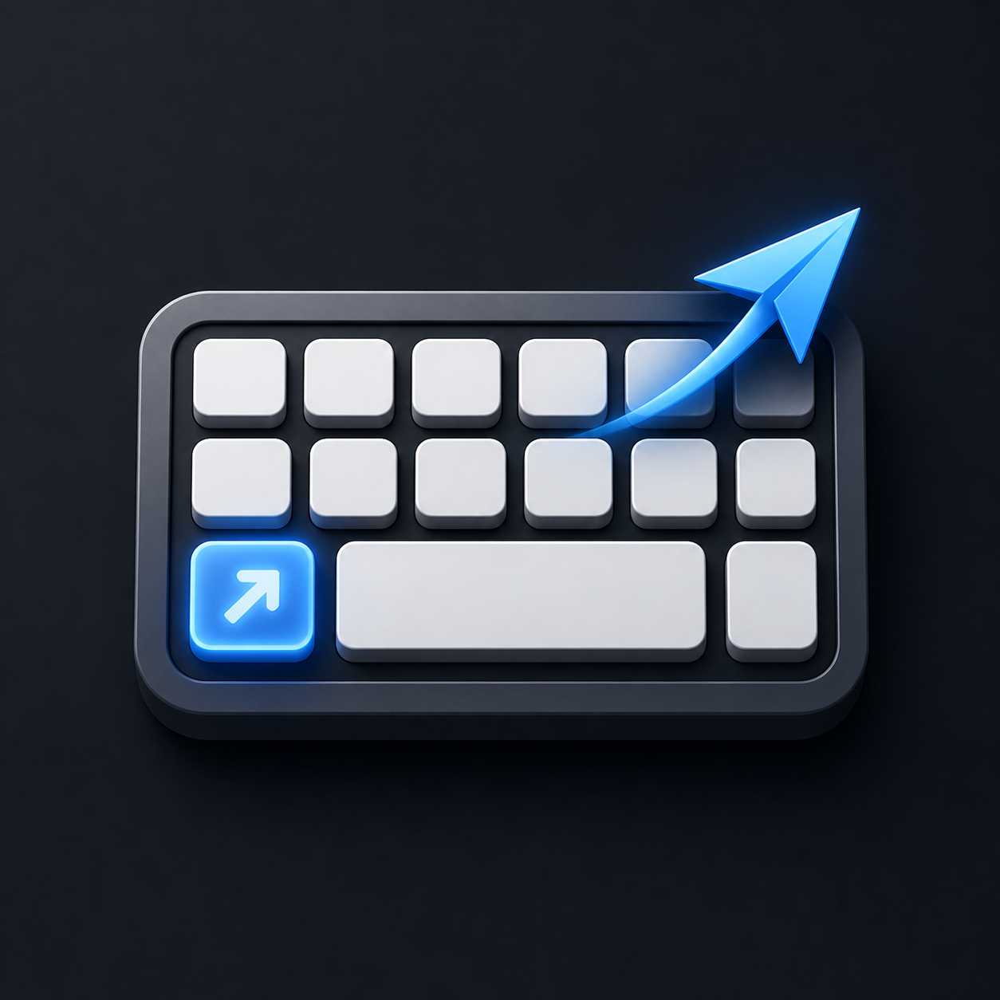
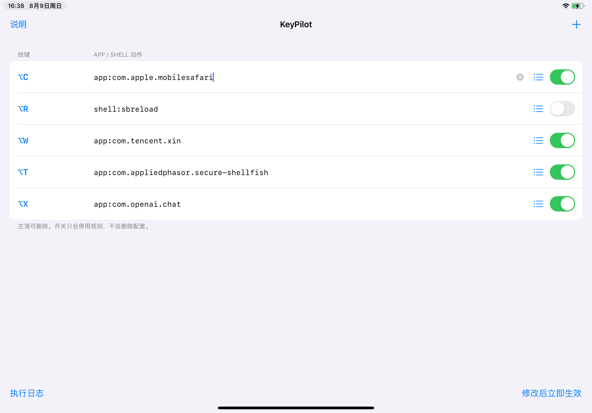

# KeyPilot

<p align="center">
  
</p>

<p align="center">
  Global hardware-keyboard shortcuts for jailbroken iPadOS.
</p>

<p align="center">
  English · <a href="README.zh-CN.md">简体中文</a>
</p>

KeyPilot is a rootless iPadOS tweak with a standalone configuration app. Record a hardware-keyboard shortcut, select an installed app, and use the shortcut globally to launch it or bring its existing process to the foreground. URL and shell actions are also supported.

## Screenshot

<p align="center">
  
</p>

## Features

- Optional direct window-layout shortcuts and real Home through a custom MacStatusBar&Dock bridge
- Captures shortcuts in SpringBoard and foreground UIKit apps
- Visual shortcut recording; no HID key codes to enter
- Searchable installed-app picker with automatic Bundle ID entry
- Launches or foregrounds apps through Conrad Kramer's `open` utility
- Supports Control, Option, Shift, Command, Caps Lock, arrows, Escape, and more
- Supports `url:`, `shell:`, and `sh:` actions
- Up to 64 rules with enable/disable, swipe-to-delete, and duplicate detection
- Applies configuration changes immediately without a respring
- Triggers once per physical key press with debounce protection
- English and Simplified Chinese interface, following the system language
- Execution log at `/var/mobile/Library/KeyPilot/keypilot.log`

## Compatibility

- Rootless iPadOS 15 or later
- arm64 and arm64e
- A jailbreak with UIKit/SpringBoard tweak injection, such as ElleKit or MobileSubstrate
- `com.conradkramer.open` from BigBoss

The development target is an M1 iPad running iPadOS 17.0. TrollStore by itself is not sufficient because KeyPilot requires tweak injection.

## Action syntax

The local 0.4.2 core opens new windows at Fill and disables automatic tiling and its side-selection prompt. KeyPilot adds Command+H → `system:home` once; that rule can be edited or disabled in the rule list.

### Window layouts (0.4.1, local integration)

Use the list button → **Window Layout** to choose a layout. This integration requires a custom [MacStatusBar&Dock](https://github.com/BesiktasliSeba/MacStatusBarAndDock) core with the KeyPilot layout bridge and an enabled window engine. KeyPilot calls its layout function directly without opening menus. Direct left-half, right-half and fill dispatch have been verified on the M1 iPad / iPadOS 17.0. See the [developer handoff, API contract and window-only patch](integrations/WINDOW_MANAGEMENT.md).

The 0.4.3 integration is published as source for developer reference, not as a new binary release. The bridge exports are custom additions, not APIs assumed to exist in the stock upstream package. Dock positioning and input-method experiments are not included.

Actions: `window:left-half`, `window:right-half`, `window:top-half`, `window:bottom-half`, `window:top-left`, `window:top-right`, `window:bottom-left`, `window:bottom-right`, `window:fill`, `window:center`, `window:small`, `window:large`. Short forms such as `window:left` and `window:maximize` are accepted. Bind, for example, Control+Option+Left to `window:left-half`.

The action uses the app window currently selected by MacStatusBar&Dock. It reports missing bridge, disabled engine, full-screen-only app, lock screen and in-progress workspace transitions in Execution Log. Installing stock upstream updates replaces the custom core and requires rebuilding the bridge. MacStatusBar&Dock's GPL sources are maintained separately from the MIT KeyPilot client.

| Syntax | Action | Example |
|---|---|---|
| `app:<bundle-id>` | Launch or foreground an app | `app:com.apple.mobilesafari` |
| `open:<bundle-id>` | Alias of `app:` | `open:com.apple.Preferences` |
| `url:<URL>` | Open a URL or URL scheme | `url:https://example.com` |
| `shell:<command>` | Run with `/bin/sh -c` | `shell:touch /var/mobile/keypilot-test` |
| `sh:<command>` | Alias of `shell:` | `sh:date` |
| No prefix | Treat as an app Bundle ID | `com.apple.mobilesafari` |

Shell commands run as the `mobile` user. They can still delete data or cause repeated SpringBoard crashes, so only configure commands you understand.

## Installation

Download the rootless `.deb` from [Releases](https://github.com/wanghuangjie/KeyPilot/releases), install it with Sileo or Zebra, then respring. BigBoss's `com.conradkramer.open` package is a required dependency.

Open KeyPilot from the Home Screen, add a rule, record a shortcut, and use the list button to select the target app.

## Building

Install [Theos](https://theos.dev/docs/installation), then run:

```sh
export THEOS=/path/to/theos
make clean package FINALPACKAGE=1
```

The rootless package is written to `packages/`.

## Architecture

The frontmost UIKit process observes hardware-keyboard `UIPressesEvent` events and matches compact rule signatures distributed through Darwin notification state. It then notifies SpringBoard, where KeyPilot launches the app, opens the URL, or spawns the shell command.

This split is necessary because SpringBoard does not normally receive keyboard events while another app owns keyboard focus.

## Troubleshooting and recovery

- If a shortcut works on SpringBoard but not in a specific app, verify that your tweak-injection manager does not exclude that app.
- Apps that read raw HID input instead of UIKit events are not currently supported.
- If a shell rule causes repeated resprings, enter your jailbreak's safe/disabled-tweaks mode and uninstall `com.whj.keypilot`.
- KeyPilot does not modify iPadOS system files. Its preferences use the `com.whj.keypilot` domain.

## Support development

If KeyPilot is useful to you, donations are welcome via PayPal: **wanghuangjie@vip.qq.com**

## License

KeyPilot is released under the [MIT License](LICENSE).

The MacStatusBar&Dock bridge and upstream patch in `integrations/` are separately
licensed GPL-3.0-only; see [developer integration licensing](integrations/WINDOW_MANAGEMENT.md#source-patch-and-build-boundary).
