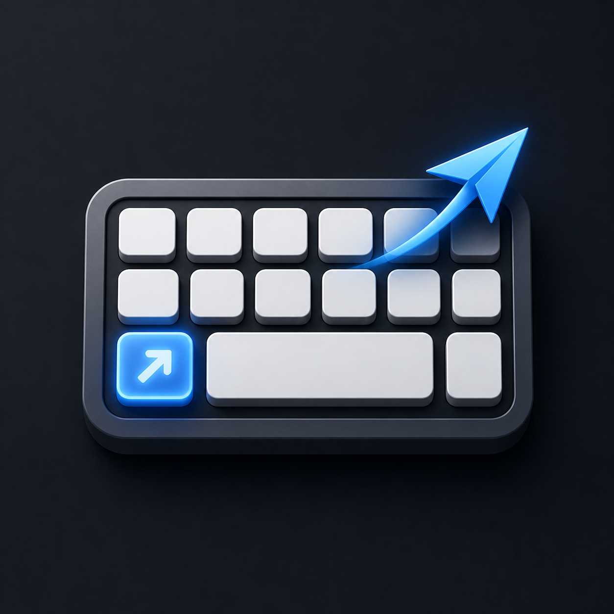
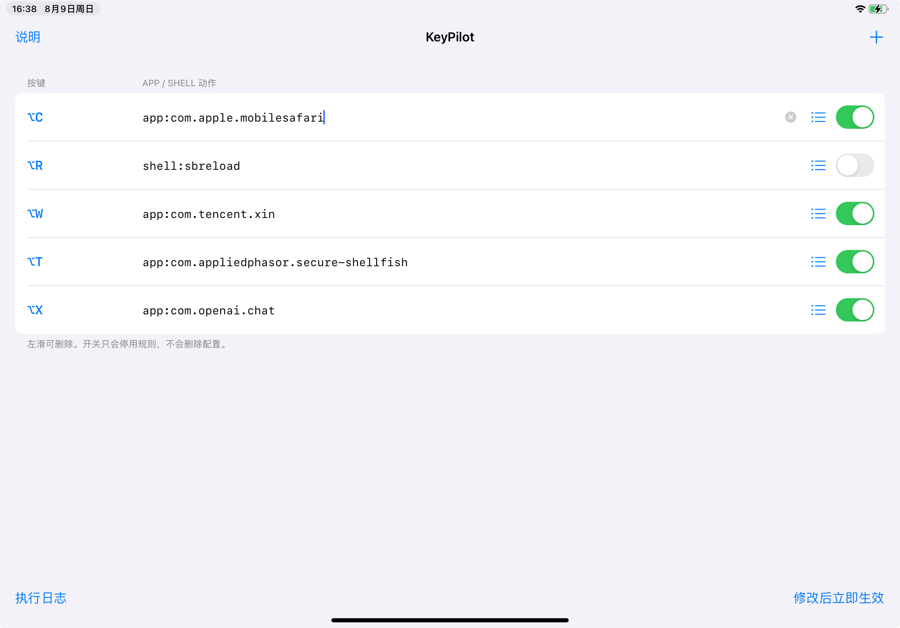

# KeyPilot

<p align="center">
  
</p>

<p align="center">
  越狱 iPadOS 全局硬件键盘快捷键。
</p>

<p align="center">
  <a href="README.md">English</a> · 简体中文
</p>

KeyPilot 是一个面向 rootless 越狱 iPadOS 的 tweak，带独立配置 App。录入硬件键盘组合键并选择已安装 App 后，即可在全局启动它；如果 App 已在后台，则直接切回前台。同时保留 URL 和 shell 动作。

## 界面截图

<p align="center">
  
</p>

## 主要功能

- 可选窗口布局快捷键与真正返回主页（需要带桥接接口的 MacStatusBar&Dock 核心）
- 在 SpringBoard 和前台 UIKit App 中捕获快捷键
- 图形化录入组合键，无需手写 HID key code
- 搜索并手动选择已安装 App，自动填写 Bundle ID
- 通过 Conrad Kramer 的 `open` 工具启动 App 或切回现有进程
- 支持 Control、Option、Shift、Command、Caps Lock、方向键、Esc 等
- 支持 `url:`、`shell:` 和 `sh:` 动作
- 最多 64 条规则，支持启用/停用、左滑删除和重复检测
- 修改配置后立即生效，无需 respring
- 每次实体按键只触发一次，带防抖
- 简体中文/英文界面，自动跟随系统语言
- 执行日志：`/var/mobile/Library/KeyPilot/keypilot.log`

## 兼容性

- rootless iPadOS 15 或更高版本
- arm64 和 arm64e
- 具备 UIKit/SpringBoard tweak 注入能力的越狱，如 ElleKit 或 MobileSubstrate
- 依赖 BigBoss 源的 `com.conradkramer.open`

开发目标设备是 iPadOS 17.0 的 M1 iPad。仅有 TrollStore 不够，KeyPilot 需要 tweak 注入环境。

## 动作语法

0.4.2 本地版：新窗口默认填满可用区域，关闭自动平铺及左右选择提示；可继续用快捷键调整半屏。首次升级会添加 Command+H → `system:home` 返回主屏幕，之后可在规则列表修改或停用。

### 窗口布局（0.4.1，本地集成版）

点右侧列表按钮 → **窗口布局**，可选择左右半屏、上下半屏、四个角、填满屏幕、居中和大小窗口。需要安装带 KeyPilot 桥接接口的 [MacStatusBar&Dock](https://github.com/BesiktasliSeba/MacStatusBarAndDock) 核心并启用窗口引擎。此版本直接调用布局函数，不展开菜单。已在 M1 iPad / iPadOS 17.0 上验证左半屏、右半屏和填满屏幕的直达调用；[开发者对接说明与窗口专用补丁](integrations/WINDOW_MANAGEMENT.md)。

0.4.3 集成代码作为开发者参考源码公开，本次不发布新的二进制安装包。桥接接口是本地新增接口，不是上游原版默认提供的 API；不包含 Dock 定位或输入法实验。

支持 `window:left-half`、`window:right-half`、`window:top-half`、`window:bottom-half`、`window:top-left`、`window:top-right`、`window:bottom-left`、`window:bottom-right`、`window:fill`、`window:center`、`window:small`、`window:large`。也可简写为 `window:left`、`window:right`、`window:top`、`window:bottom`；`window:maximize` 等同于 `window:fill`。

例如录入 Control+Option+左方向键，选择“左半屏”，之后在目标 App 窗口按下即可。接口未加载、窗口引擎禁用、App 必须全屏、锁屏或工作区正在切换时，“执行日志”会说明原因。以后升级上游 MacStatusBar&Dock 会覆盖定制核心，需要为新版本重新构建桥接。GPL 上游源码与 MIT KeyPilot 客户端分别维护。

| 写法 | 含义 | 示例 |
|---|---|---|
| `app:<bundle-id>` | 启动 App 或切回前台 | `app:com.apple.mobilesafari` |
| `open:<bundle-id>` | `app:` 的别名 | `open:com.apple.Preferences` |
| `url:<URL>` | 打开 URL 或 URL Scheme | `url:https://example.com` |
| `shell:<命令>` | 用 `/bin/sh -c` 执行 | `shell:touch /var/mobile/keypilot-test` |
| `sh:<命令>` | `shell:` 的别名 | `sh:date` |
| 无前缀 | 按 App Bundle ID 处理 | `com.apple.mobilesafari` |

shell 命令以 `mobile` 用户执行，仍可能删除数据或导致 SpringBoard 反复崩溃，只配置自己理解的命令。

## 安装

从 [Releases](https://github.com/wanghuangjie/KeyPilot/releases) 下载 rootless `.deb`，使用 Sileo 或 Zebra 安装后 respring。必须同时安装 BigBoss 的 `com.conradkramer.open`。

打开桌面上的 KeyPilot，添加规则，录入组合键，再通过列表按钮选择目标 App。

## 编译

安装 [Theos](https://theos.dev/docs/installation)，在项目根目录执行：

```sh
export THEOS=/path/to/theos
make clean package FINALPACKAGE=1
```

rootless 安装包会生成在 `packages/` 目录。

## 故障恢复

- 如果快捷键只在桌面有效，请检查 tweak 注入管理器是否排除了对应 App。
- 直接读取底层 HID 而不经过 UIKit 的 App 目前不支持。
- 若 shell 规则导致反复 respring，进入越狱安全/禁用 tweak 模式，然后卸载 `com.whj.keypilot`。
- KeyPilot 不修改 iPadOS 系统文件，配置 domain 为 `com.whj.keypilot`。

## 支持开发

如果 KeyPilot 对你有帮助，欢迎通过 PayPal 捐赠：**wanghuangjie@vip.qq.com**

## 开源协议

KeyPilot 使用 [MIT License](LICENSE) 开源。

`integrations/` 中的 MacStatusBar&Dock 桥接与上游补丁单独采用 GPL-3.0-only；详见[开发者集成说明](integrations/WINDOW_MANAGEMENT.md#source-patch-and-build-boundary)。
